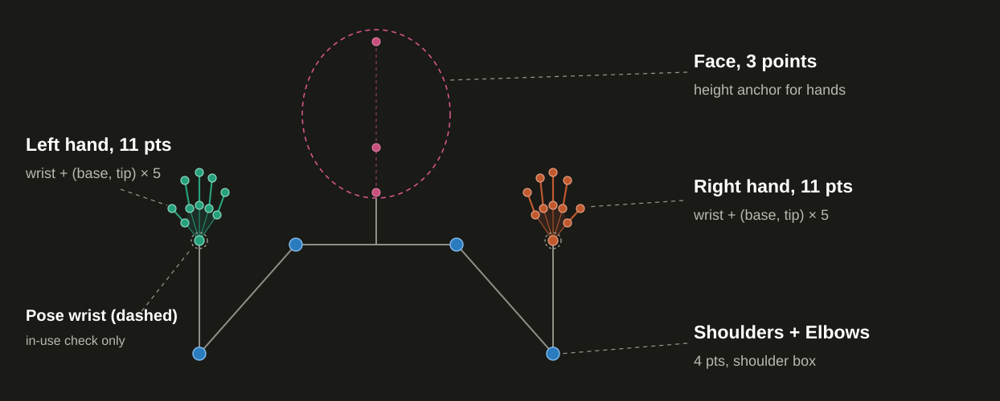

Upgrade the sign recognition system in the application to match the accuracy, performance, and recognition behavior of `model_training_zone\dl_nondl_recognize.py`.

The application currently does not perform as well as the Python test model. Analyze the complete recognition pipeline in `model_training_zone\dl_nondl_recognize.py`, compare it with the application's implementation, identify all differences and missing features, and update the application accordingly.

Goal: Make the application's live sign recognition work as closely as possible to the Python test model. This includes feature extraction, preprocessing, prediction, confidence handling, temporal smoothing, and sign-detection logic. Draw the MediaPipe skeleton, shown in , over the live feed. The camera feed area can also be increased to nearly full-screen to accommodate these elements.

Do not modify anything inside `model_training_zone`; use it only as the reference implementation. Preserve the existing application architecture and UI wherever possible.

Update `model_training_zone\training-method\training_method.md` if recognition or related details change, and document them there when necessary.