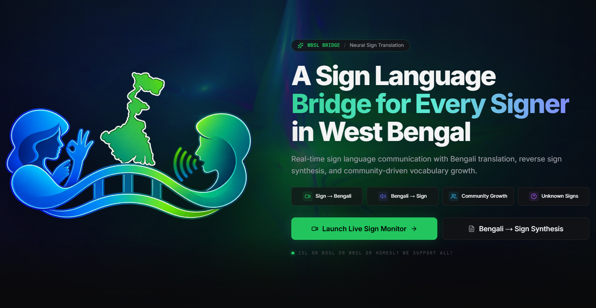

**Academic Session: 2025–2026 | B.Tech 7th Semester**

### Project Title:
# WBSL Bridge

### Academic Title:
## WBSL Bridge: Intent-Aware Bidirectional Sign Language Communication for the Deaf Community of West Bengal with Unknown Sign Handling and Community-Driven Growth

---

### SUBMITTED BY:

*   **SABIR ALI MONDAL** | University Roll No: **34900123032**
*   **KOUSHAKI SINGHA** | University Roll No: **34900124074**
*   **MONIRUL HALDER** | University Roll No: **34900123021**
*   **FIRDOS SHAKIH** | University Roll No: **34900123011**

**Project Supervisor:** Prof. Prabir Kr. Naskar, Assistant Professor, Department of CSE

---

## ABSTRACT

Sign language is a visual-spatial language where clausal syntax, negation, questions, and emotion are expressed concurrently through hand movements, non-manual markers (NMMs), and body orientation. Most existing sign language tools perform word-by-word transliteration of hand shapes into isolated text, completely discarding facial and head markers. This causes severe mistranslations—such as inverting a negated question into an affirmative statement. 

Furthermore, while systems such as Google DeepMind's SL2T (2026) demonstrated high-resource real-time American Sign Language (ASL) translation on smartphones using over 100,000 hours of training data, regional languages in India remain unserved. Specifically, **West Bengal Sign Language (WBSL)** has been proven statistically and linguistically distinct from both Northern Delhi Indian Sign Language (ISL) and Bangladeshi Sign Language (BdSL) (*Johnson & Johnson, Sign Language Studies, 2016*). Despite serving hundreds of thousands of Deaf individuals in West Bengal, WBSL has zero dedicated deep learning models, zero continuous video datasets, and zero bidirectional translation pipelines.

**WBSL Bridge** addresses this technological void by providing an edge-deployable, bidirectional, intent-aware sign translation framework that operates on consumer-tier CPUs without cloud dependencies. The forward pipeline (Sign to Bengali) captures frames at 30 FPS, extracting normalized coordinate vectors across two feature contracts: a 126-dimensional hand vector and a 258-dimensional holistic vector (126 hand coordinates + 132 BlazePose body coordinates). Grammatical NMMs (eyebrow raises/furrows, head shakes/nods, mouth aperture) are processed in sub-5ms latency using deterministic spatial algorithms, while facial affect is classified across 7 emotion categories using a Vision Transformer (ViT) exported to ONNX. Continuous signing is buffered in a server-side rolling deque (180 frames) and parsed across multi-scale sliding windows (24 and 32 frames) governed by kinematic motion and spatial spread gating. 

Classification is driven by **DailyNet**, a temporal Bidirectional Long Short-Term Memory (BiLSTM) network with linear attention pooling, velocity delta channels, and hand-presence gating ($518 \to 128 \to C$), achieving 100% validation accuracy across core conversational classes including a dedicated background idle class (`NONE`). The resulting gloss sequence, grammatical flags, and affect states are passed to a local Small Language Model (e.g., `gemma-4-E4B`) governed by a 50-criteria anti-hallucinatory prompt. The model outputs grammatical West Bengal Bengali via Server-Sent Events (SSE) token streaming, which is then spoken using an automatic dual-engine Text-to-Speech fallback chain (`edge-tts` to offline `BanglaTTS`). 

The reverse pipeline (Bengali to Sign) transcribes spoken audio via an int8-quantized `faster-whisper` engine with strict ISO language locking, maps text into sign glosses via deterministic phrase matching or LLM planning, and drives gapless playback of reference signs using a dual-engine video player with canvas fallback. To allow safe dataset growth, the system implements an ingestion pipeline compliant with India's **Digital Personal Data Protection (DPDP) Act 2023**, stripping raw video on-device and saving only normalized float32 kinematic matrices for human-in-the-loop review. The entire system is implemented across a unified Python 3.11 FastAPI backend and a Next.js 16 / React 19 web interface.

## Tech Stack

- AI & Machine Learning: MediaPipe, LSTM, ONNX Runtime, Vision Transformer (ViT), Emotion Classification
- Large Language Models (LLMs): Gemma 4B, KoboldCpp, Local LLM Inference
- Speech Technologies: Whisper STT, Edge TTS, BanglaTTS, ElevenLabs TTS/STT
- Computer Vision: OpenCV, Facial Landmark Detection, Real-Time Emotion Recognition
- Data Processing & Numerical Computing: NumPy, `.npy` File Format
- Frontend Development: React, Vite, Three.js
- Backend & Programming: Python
- Model Deployment & Optimization: ONNX, KoboldCpp, Edge AI Inference
- 3D Visualization & Animation: Three.js
- Additional Technologies: Silero VAD

