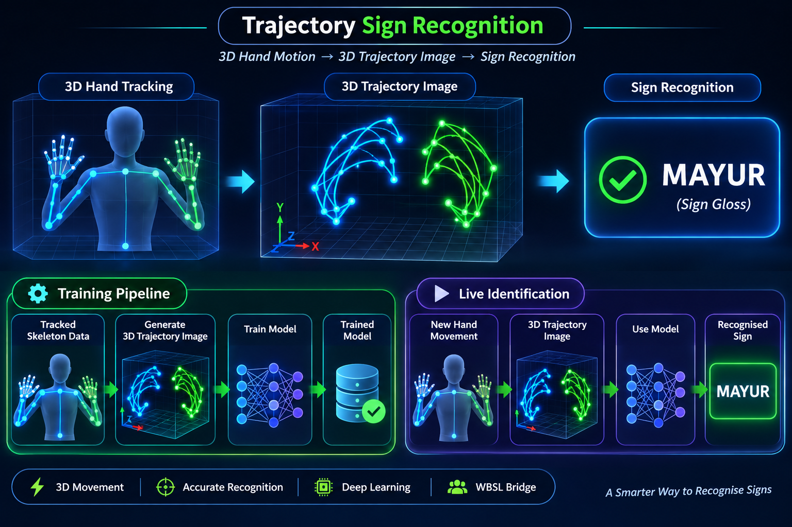

# 3D Trajectory-Based Sign Recognition

## 1. Concept

Explore an alternative training approach for WBSL Bridge by converting tracked hand and finger movements into **3D trajectory images** and using an image-classification model for sign recognition.

WBSL Bridge will remain a sign-language detection system. The objective is to recognise sign-language glosses from hand movements.

Unlike 2D trajectory images, 3D trajectories preserve movement through three-dimensional space using X, Y and Z coordinates.

## System Visualization

*Visualization of 3D hand tracking, trajectory generation and sign identification.*

## 2. Training Pipeline

### Step 1: Tracked Skeleton Data
- Reuse the existing WBSL Bridge skeleton extraction pipeline.
- Collect both hands and all 21 landmarks per hand.
- Preserve frame-by-frame 3D coordinates.
- Maintain movement information over time.

### Step 2: 3D Trajectory Image Generation
- Convert tracked hand and finger movements into 3D trajectories.
- Represent movement paths in X, Y and Z dimensions.
- Preserve movement direction and spatial relationships.
- Generate visual 3D trajectory representations for each sign sample.

### Step 3: Dataset Preparation
- Generate trajectory images from collected sign samples.
- Associate each generated image with its original sign gloss.
- Organise images into labelled sign classes.

### Step 4: Model Training
- Train an image-classification model using the generated 3D trajectory images.
- Save the trained model for sign recognition.

## 3. Live Sign Identification Pipeline

### Step 1: Live Skeleton Tracking
- Capture new sign movements through a camera.
- Extract both-hand and finger skeleton landmarks.
- Preserve their 3D coordinates.

### Step 2: 3D Trajectory Image Generation
- Convert live skeleton movements into 3D trajectory images.
- Apply the same generation and preprocessing rules used during training.

### Step 3: Sign Identification
- Pass the generated 3D trajectory image to the trained model.
- Predict the corresponding sign gloss.

### Step 4: Recognition Output
- Return the recognised sign gloss to the existing WBSL Bridge pipeline.
- Preserve the existing unknown-sign handling mechanism.

## 4. System Architecture

### Training Pipeline

Tracked 3D Skeleton Data → 3D Trajectory Image Generation → Labelled Dataset → Image Classification Model Training → Trained Model

### Live Identification Pipeline

Live Camera → 3D Skeleton Extraction → 3D Trajectory Image Generation → Trained Model → Sign Gloss Identification

## 5. Important Technical Considerations

- Use actual 3D coordinates rather than flattening movements into 2D.
- Include both hands and individual finger movements.
- Preserve movement direction and temporal information.
- Use consistent coordinate normalisation and camera-relative positioning.
- Maintain identical trajectory-generation rules during training and live identification.
- Consider multiple viewing angles or projections if a single 3D representation loses important spatial information.
- Compare recognition accuracy against the existing 98-feature BiLSTM approach.

## 6. Initial Experiment

Start with a small selection of existing sign classes.

1. Extract 3D skeleton sequences.
2. Generate their 3D trajectory representations.
3. Create a labelled dataset.
4. Train an image-classification model.
5. Test recognition using unseen sign videos.
6. Compare its performance with the existing recognition model.

## 7. Main Objective

Explore whether 3D trajectory-based visual learning can provide an effective alternative to sequence-based skeleton learning for sign-language recognition.

The existing WBSL Bridge skeleton extraction capabilities will serve as the foundation.

**Core Idea: 3D Skeleton Tracking → 3D Trajectory Images → Image Model Training → Live Sign Recognition.**

*This is an experimental alternative, not a replacement for the current sign recognition system until its performance is evaluated.*