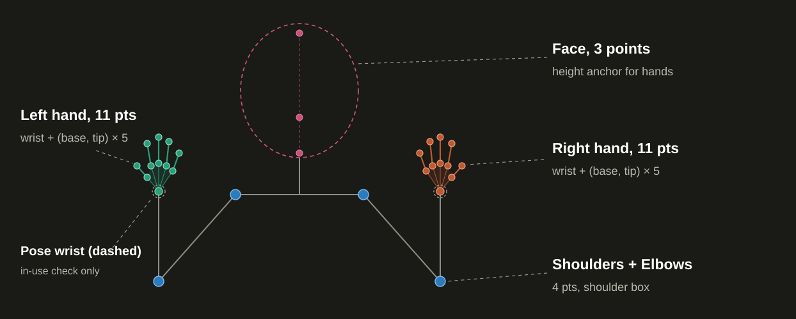
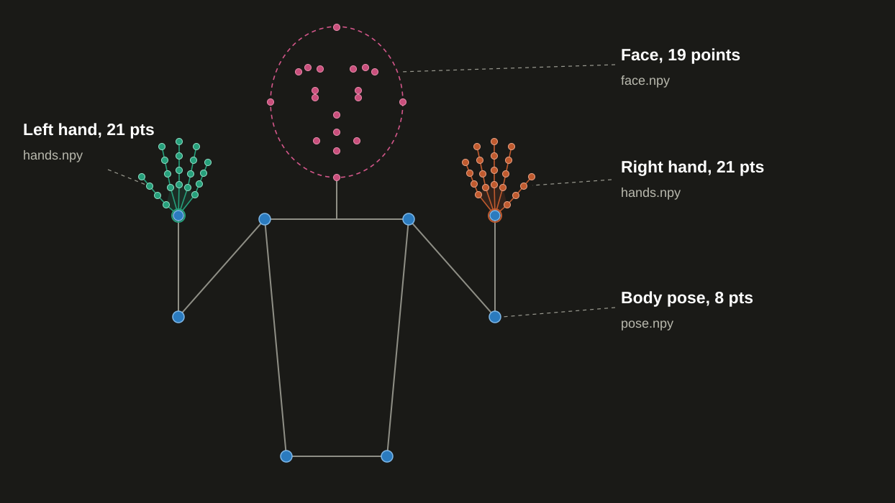

# Sign Recognition – Training Method

## Overview

This document describes how the Indian Sign Language recognition model is trained
and how it is later used for live detection. Avatar data is extracted separately.

---

## Skeleton used for training



| Part | Points | Source |
|------|--------|--------|
| Hands | 11 per hand – wrist, thumb base & tip, base & tip of index, middle, ring, pinky | MediaPipe Hand indices 0,1,4,5,8,9,12,13,16,17,20 |
| Elbows | 2 | Pose 13, 14 |
| Shoulders | 2 – set origin & scale of the shoulder box | Pose 11, 12 |
| Face | Forehead, mouth, chin | Face-mesh 10, mid(13,14), 152 |

The **wrist is the hand origin**: handshape is measured relative to it, and its
position in the shoulder box carries the hand's location. No palm centre is used.

Pose wrists (15, 16) are read **only** to decide whether a hand is in use.
Nothing else is used – no hips, legs, extra face points, visibility scores or expressions.

---

## Skeleton used for avatar



| Part | Count | Indices |
|------|-------|---------|
| Hands | 21 × 2 = 42 | All MediaPipe hand landmarks |
| Body | 8 | Pose 11,12,13,14,15,16,23,24 |
| Face | 19 | Mesh 10,152,234,454,70,105,107,300,334,336,159,145,386,374,1,61,291,0,17 |

---

## Coordinate system – the Shoulder Box

All positions and directions are expressed in the **shoulder box**.

- **Origin** – midpoint of the two shoulders.
- **x-axis** – along the shoulder line.
- **y-axis** – perpendicular to it in the image plane.
- **Unit** – one shoulder width.

---

## Frame completeness

A frame is *complete* when **all** of these hold:

1. Every hand that is *in use* has all 21 MediaPipe points detected.
2. Both shoulders and both elbows have visibility ≥ 0.5.
3. The face mesh is found.

A hand is *in use* when its pose wrist is above the **rest line** by more than 0.05.
The rest line is the hip line when both hips are visible; otherwise shoulder-mid + 1.3 × shoulder-width.
A hand not in use is stored as zeros with flag = 0.

---

## Sign span detection

Frames are read in order.

- **Start** – a wrist is above the rest line for 3 consecutive frames; 8 frames before it are kept.
- **End** – both hands are below the rest line for 10 consecutive frames; trailing frames are cut, keeping 2.
- A video with no valid span is **rejected**.

The same rule applies to dataset videos and live webcam clips.

---

## Frame selection (64 frames)

Given a span of F frames, the 64 target positions are:

```
position[i] = round(i × (F − 1) / 63)      for i = 0 … 63
```

For each position the **first complete frame at or after it** is used.

- Reject the video if any position needs a frame > 5 frames after its target.
- Reject if no complete frame exists for a position.
- When F < 64 some frames repeat.

---

## Feature vector – 98 numbers per frame

| Group | What it captures | Numbers |
|-------|-----------------|---------|
| Handshape | 11 points relative to wrist, normalised by palm size (wrist → middle base), rotated so wrist→middle-base points up; x,y,z both hands | 66 |
| Palm direction & facing | Unit vector wrist→middle-base + unit palm normal, in shoulder box; per hand | 12 |
| Wrist position | x, y in shoulder box, both hands | 4 |
| Elbows | x, y in shoulder box | 4 |
| Wrist-to-face distances | Each wrist to forehead, mouth, chin | 6 |
| Head | Mouth x,y in shoulder box + forehead-to-chin angle from vertical | 3 |
| Hand flags | 1 = in use & complete, 0 otherwise | 2 |
| Clip duration | Seconds of the sign span (same value in all 64 frames) | 1 |
| **Total** | | **98** |

Model input shape: **(64, 98)** float32.

---

## Extraction – `extract.py`

```
py extract.py
```

- Reads **every** video in **every** gloss folder under `ISL_VIDEO/`.
- Folder name → class name (uppercased, spaces → `_`).
- Fresh MediaPipe Holistic per video; second hand detector on missed frames.
- Finds span → selects 64 frames → computes 98 features.
- Parallel processing with a progress line.
- Output (new id each run):

```
model_training_zone/dataset_train/features/<id>/
├── <GLOSS>.npy            shape (N, 64, 98)
└── extract_report.json    kept / rejected videos with reasons
```

---

## Training – `train.py`

```
py train.py
```

Reads features from the **newest** id (or `FEATURES_ID` set at the top of the script).

### Model architecture

- **BiLSTM** with attention pooling.
- Hidden size 128, 2 layers, dropout 0.3.
- Hand flags taken from the two flag columns.

### Training recipe

| Parameter | Value |
|-----------|-------|
| Optimiser | AdamW |
| Learning rate | 2 × 10⁻³ |
| Weight decay | 1 × 10⁻² |
| Batch size | 32 |
| Max epochs | 15 |
| Label smoothing | 0.1 |
| LR schedule | One-cycle |
| Early stop | 10 epochs without improvement |
| Best epoch | Kept |

### Data split

- 20 % of each gloss's videos held out for validation (minimum 2).
- Split is **by video**, not by frame.

### Augmentation

- 4 noisy copies per training video.
- Gaussian noise σ = 0.01 on position numbers.

### Output

```
models/onnx_models/<id>/
├── sign_daily_lstm.onnx        input (batch, 64, 98) → logits
├── sign_daily_classes.json     gloss names in output order
├── daily_report.json           best val accuracy, features id used
└── avatar/                     (written next by avatar_extract.py)
```

---

## Avatar extraction – `avatar_extract.py`

```
py avatar_extract.py
```

Runs **after** `train.py` and writes into the **same** model folder.

- Picks **one** video per gloss – the one with the highest share of complete frames in its span (ties → first in sorted order).
- Keeps **every** complete frame of the span with its timestamp. No resampling.

```
models/onnx_models/<id>/avatar/<GLOSS>/
├── pose.npy     (F, 8, 4)   x, y, z, visibility
├── hands.npy    (F, 42, 3)  left 21 + right 21
├── face.npy     (F, 19, 3)  float16
├── t.npy        (F,)        seconds
└── meta.json    source video, frame rate
```

---

## Live detection – `test_model.py`

```
py test_model.py
```

1. Webcam frames → MediaPipe Holistic.
2. Sign-span rule detects start / end of a sign.
3. At span end, 64 frames are selected and 98 features computed (same code as training).
4. If a position cannot be filled → **"Hands not clear, try again"**.
5. Model returns class probabilities → top 3 shown.
6. If top probability < 0.5 **or** gap to second < 0.15 → **"Not sure"**.

| Key | Action |
|-----|--------|
| SPACE | Start / stop manual recording |
| M | Toggle auto ↔ manual |
| Q / ESC | Quit |

---

## Run order

```bash
py extract.py
py train.py
py avatar_extract.py
py test_model.py
```

---

## Final directory layout

```
model_training_zone/
├── dataset/Indian Sign Language_Dataset/ISL_VIDEO/
│   ├── hello/
│   │   ├── video1.mp4
│   │   └── video2.mp4
│   ├── thanks/
│   │   └── video1.mp4
│   └── …
│
├── dataset_train/features/
│   └── <features_id>/
│       ├── <GLOSS>.npy
│       └── extract_report.json
│
models/onnx_models/
└── <model_id>/
    ├── sign_daily_lstm.onnx
    ├── sign_daily_classes.json
    ├── daily_report.json
    └── avatar/
        └── <GLOSS>/
            ├── pose.npy
            ├── hands.npy
            ├── face.npy
            ├── t.npy
            └── meta.json
```