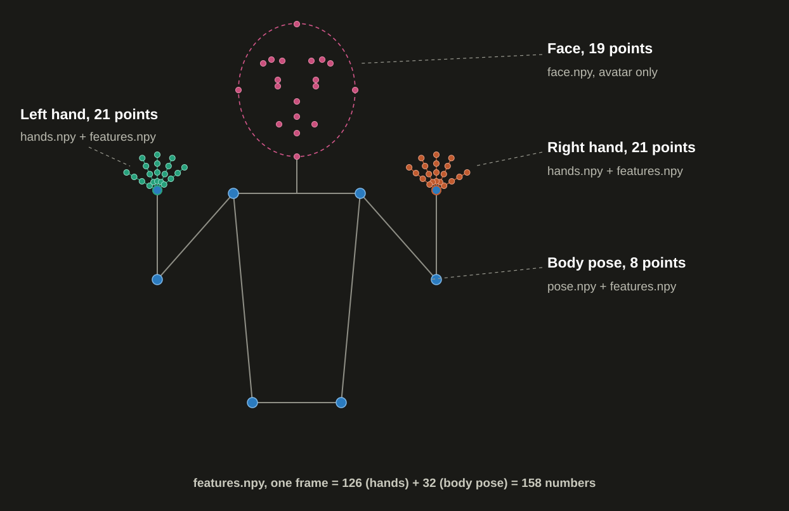

# ISL sign recognition: extract, train, test

Three scripts, run by hand, in this order. No arguments: edit the settings block at the top of each file.

```
py extract.py      # videos -> npy files in the next model id folder
py train.py        # npy files -> ONNX model in the same folder
py test_model.py   # live webcam test of the newest trained model
```

Put the three files in the same folder (they import each other). `ROOT` is the parent of that folder and must contain `model_training_zone/` and `models/`.

Every folder under `ISL_VIDEO` is one gloss class. All folders are extracted, trained and predicted identically — there is no special-cased class anywhere in the pipeline.

## Directory pattern

### 1. Input videos (you provide these)

```
<ROOT>/model_training_zone/dataset/Indian Sign Language_Dataset/ISL_VIDEO/
├── hello/
│   ├── video1.mp4
│   └── video2.mp4
├── thanks/
│   └── video1.mp4
└── ... one folder per gloss ...
```

The folder name becomes the class name (uppercased, spaces become `_`).

### 2. Cache (written and read by extract.py)

```
<ROOT>/model_training_zone/dataset_train/daily_video_body158/
── HELLO/
│   ├── features.npy   (N, 32, 158)     training input
│   ├── pose.npy       (N, 32, 8, 4)    avatar: shoulders, elbows, wrists, hips
│   ├── hands.npy      (N, 32, 42, 3)   avatar: left 21 + right 21
│   └── face.npy       (N, 32, 19, 3)   avatar only (float16)
└── THANKS/
    └── (same 4 files)
```

### 3. Model folder (extract.py creates it and fills `npy/`, train.py adds the model, test_model.py reads)

```
<ROOT>/models/onnx_models/4/                 <- next free id: 1, 2, 3, ...
├── npy/
│   ├── HELLO/
│   │   └── (same 4 files as the cache)
│   └── THANKS/
│       └── (same 4 files)
├── sign_daily_lstm.onnx
── sign_daily_classes.json
└── daily_report.json
```

### Who writes / reads what

| Location | Written by | Read by |
|---|---|---|
| `ISL_VIDEO/` videos | you | `extract.py` |
| `dataset_train/daily_video_body158/` cache | `extract.py` | `extract.py` (skip re-work) |
| `onnx_models/<id>/npy/` | `extract.py` | `train.py`, avatar |
| `onnx_models/<id>/` model + json files | `train.py` | `test_model.py`, app |

## What is saved

`extract.py` always creates a new folder with the next id. `train.py` fills the newest folder that has `npy/` but no model yet. `test_model.py` loads the newest folder that has a trained model.

N is the number of usable videos of that sign. Video number `i` is the same video in all four files, so the avatar can use `pose[i]`, `hands[i]`, `face[i]` for one clip. Each video is sampled to 32 frames, spaced evenly from its first to its last frame; recorded live clips are sampled the same way.

A video is skipped if fewer than 16 of its 32 frames have both hands detected.

A cache is kept in `model_training_zone/dataset_train/daily_video_body158/` so re-running extract does not reprocess every video. Set `FORCE = True` in `extract.py` to ignore it.

## Parallel extraction and progress

`extract.py` processes videos in parallel worker processes, each with its own MediaPipe Holistic instance, so all CPU cores are used instead of one.

- `WORKERS` setting: `None` = automatic (about half the logical cores, capped at 6). Set a number to pin it, or `1` for serial processing.
- One live progress line shows the run state:

```
[######----] 45/120 videos | elapsed 02:13 | ETA 05:40 | 20.2 vid/min | HELLO
```

- Each gloss prints a DONE line with its usable-video count and its seconds, or `(cached)` when it came from the cache; the run ends with a total timer.
- A gloss is saved the moment its last video finishes, so an interrupted run keeps everything already printed as cache.
- Videos of a gloss are stacked in sorted order, so the saved arrays are independent of worker count and finish order.
- RAM grows with the worker count (roughly 300–500 MB per worker). On machines with little free RAM, lower `WORKERS`.

## The skeleton (one frame)

```
Face, 19 points (face.npy, avatar only)
    outline 4   forehead, chin, left cheek, right cheek
    brows   6   3 per eyebrow
    eyes    4   upper + lower lid, per eye
    nose    1   tip
    lips    4   two corners, top center, bottom center

Hands, 21 points each (hands.npy and features.npy)
    wrist + 4 points on each of 5 fingers

Body pose, 8 points (pose.npy and features.npy)
    left/right shoulder, elbow, wrist, hip
```



## The feature row (features.npy, 158 numbers per frame)

```
index   0 ..  62   left hand   21 x (x,y,z)   relative to its own wrist, scaled by hand size
index  63 .. 125   right hand  21 x (x,y,z)   same
index 126 .. 157   body pose    8 x (x,y,z,visibility)
                   relative to the middle of the shoulders, scaled by shoulder width
```

A hand that is not visible is all zeros. The model adds its own hand-present flags.
A frame where detection fails holds the last good row; a gap before the first good row stays zeros. The same rule fills gaps in live clips.

## Live sign detection (test_model.py)

- Hands down: no sign.
- Raise a hand for a few frames: the sign starts (a short pre-roll is kept).
- Both hands down for a few frames: the sign ends and is predicted.

The recorded clip goes through exactly the same code as a training video: 32 frames spaced over the full clip, 158 numbers per frame, built by `frame_idxs()` and `extract_features()` in `extract.py`.

Keys: SPACE = manual start/stop, M = toggle auto/manual, Q or ESC = quit.
The `SignBoundary` class in `extract.py` holds this logic. Use it in the app too.

## Settings

- `extract.py`: `FORCE`, `MODEL_ID`, `WORKERS`
- `train.py`: `EPOCHS`, `BS`, `LR`, `AUG_K`, `MODEL_ID`
- `test_model.py`: `MODEL_ID`, `CAMERA`, `START_IN_MANUAL`, `MAX_SECONDS`, `MIN_SECONDS`, `COUNTDOWN`, `START_FRAMES`, `END_FRAMES`, `PREROLL`, `MARGIN`, `COOLDOWN`, `TOP_K`, `MIRROR`, `SHOW_LANDMARKS`

`MODEL_ID = None` means automatic (see above). Set a number to pin a specific folder.

## For the app and the 3D avatar

- Model input is `(1, 32, 158)` float32. Build rows with `extract_features()` from `extract.py`; do not rewrite the math.
- Face sidecars are 19 points in this MediaPipe face-mesh index order: `10, 152, 234, 454, 70, 105, 107, 300, 334, 336, 159, 145, 386, 374, 1, 61, 291, 0, 17`.
- Pose sidecars are 8 points in this MediaPipe pose index order: `11, 12, 13, 14, 15, 16, 23, 24`.

## Training report (61 glosses)

- **Dataset:** 61 classes, 2,790 videos (60 videos per class, except STILL with 30).
- **Extraction:** 72.6 minutes on 6 workers (~1.5s per video).
- **Training:** Reached 100% validation accuracy by epoch 5; finished in ~7.5 minutes.
- **Model:** Saved to `models/onnx_models/4/sign_daily_lstm.onnx`.